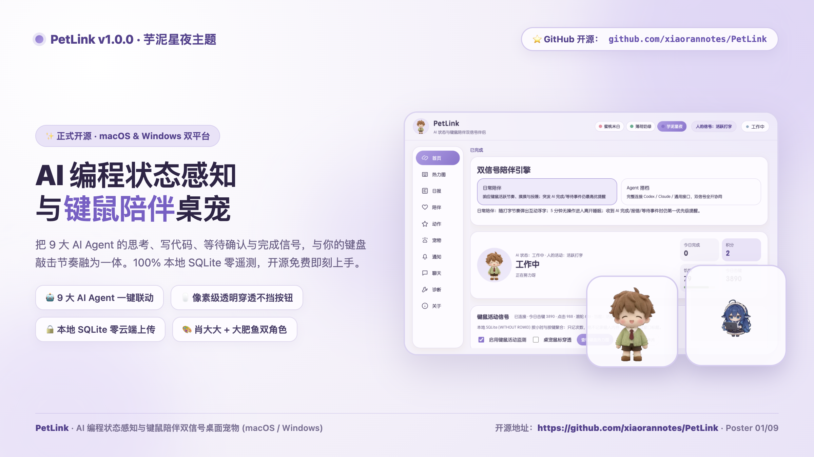
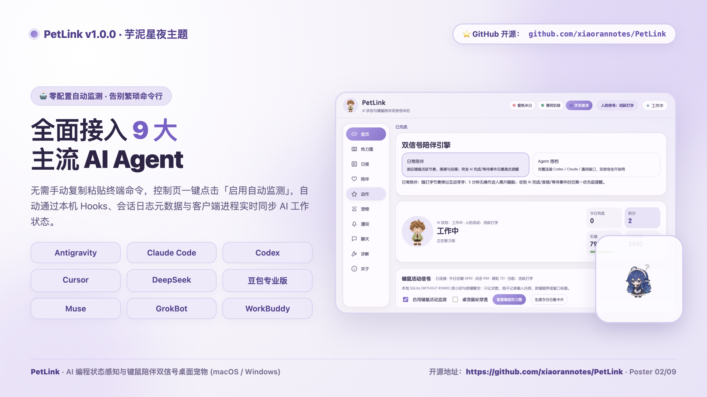
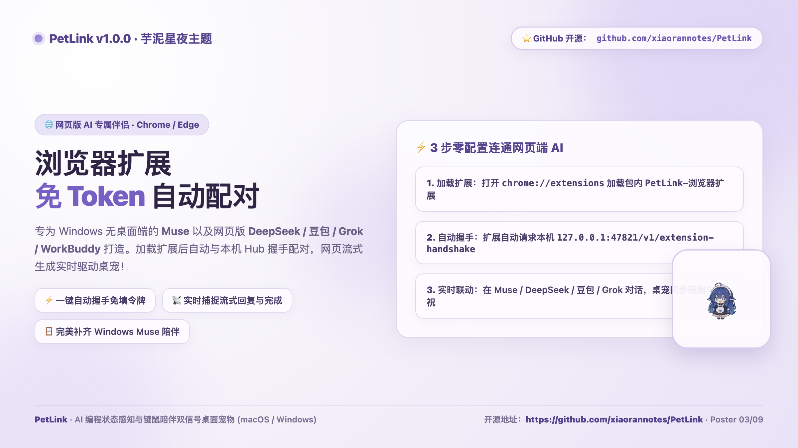
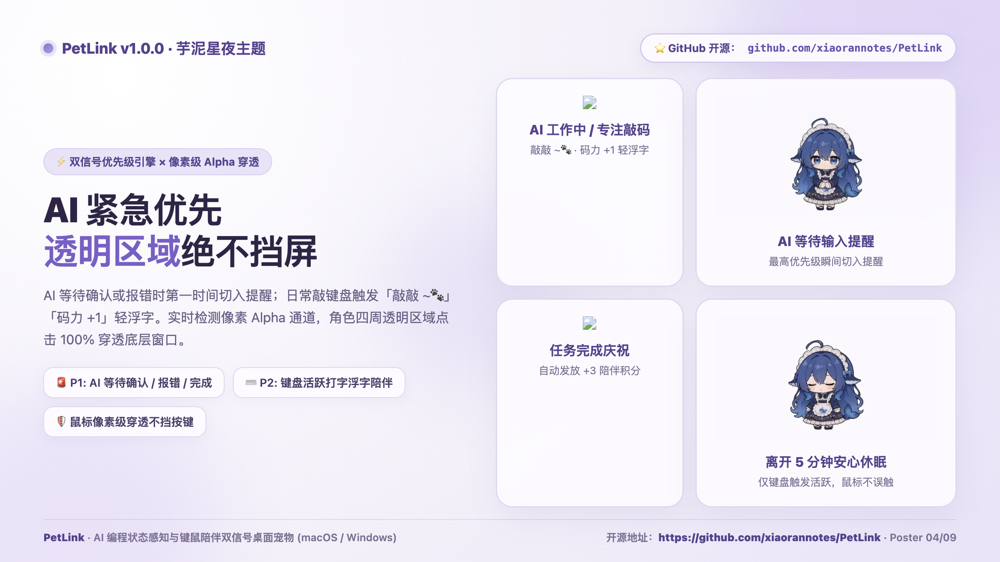
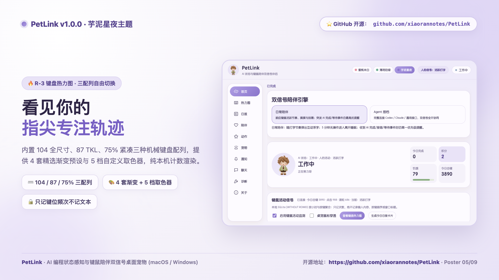
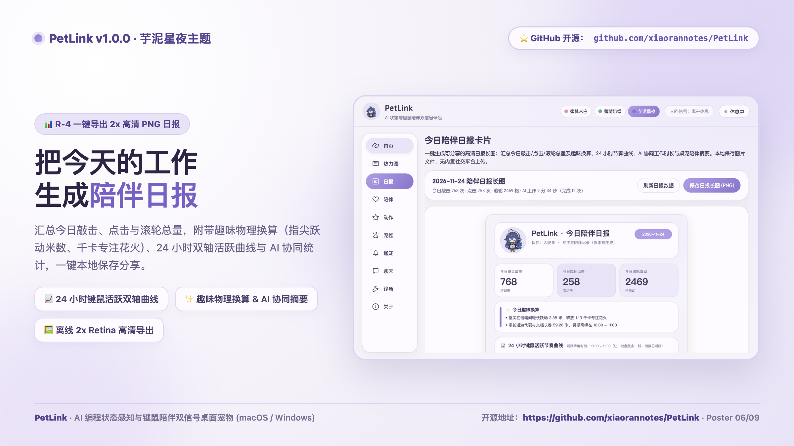
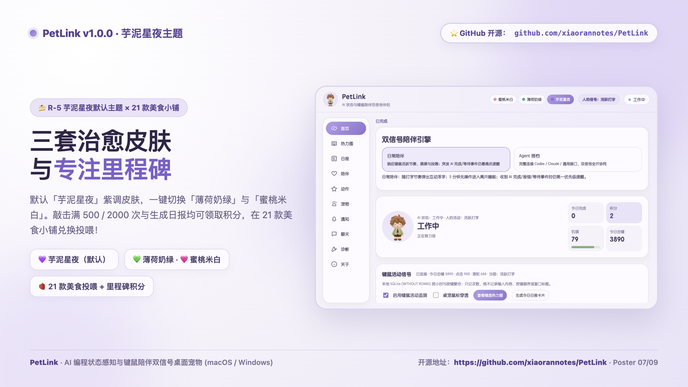
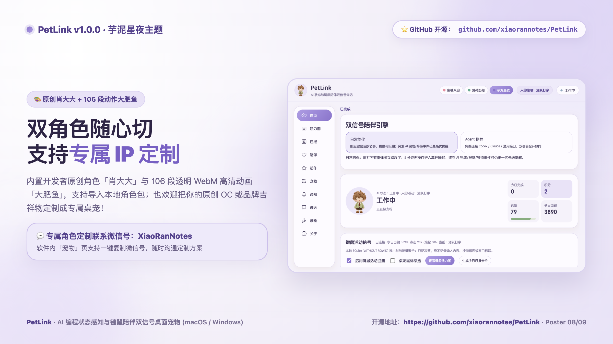
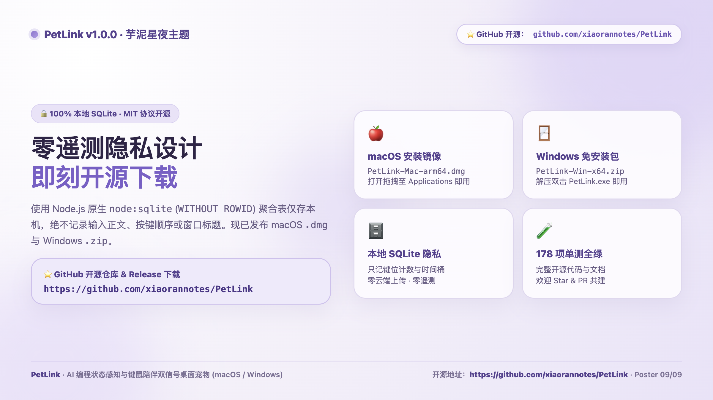

# PetLink — AI 编程状态感知与键鼠陪伴双信号桌面宠物

<p align="center">
  <strong>AI Agent 状态优先 · 键鼠活跃陪伴兜底 · 100% 本地 SQLite 零遥测隐私设计</strong>
</p>

<p align="center">
  
</p>

---

## ✨ 项目简介

**PetLink** 是一款专为开发者与创作者打造的 **AI 状态与键鼠陪伴双信号桌面宠物**（基于 Electron + Node.js 原生 `node:sqlite` 构建，支持 macOS 与 Windows）。

传统桌宠要么只看本地键盘鼠标，要么只作为单一 AI 工具的挂件。**PetLink** 创新性地将**「AI 信号（Agent 状态流）」**与**「人的信号（键盘敲击与专注节奏）」**进行双信号优先级融合：
- 当 **AI Agent** 需要你确认权限、回答问题或报错时，桌宠第一时间切入提醒动作；
- 当 **AI 正在后台思考/写代码** 或你在专注敲键盘时，桌宠化身陪跑搭子（支持 `敲敲 ~🐾`、`码力 +1` 浮动反馈与像素级鼠标点击穿透，绝不遮挡屏幕底部按钮）；
- 所有键鼠计数与 AI 会话时长 **100% 存储在本地 `node:sqlite` (`WITHOUT ROWID` 聚合表)**，只记数字不记文本，零云端遥测。

---

## 🖼️ 核心特性画廊（9 张芋泥星夜紫调海报）

| 九大 AI Agent 一键联动 | 浏览器扩展免 Token 自动配对 |
| :---: | :---: |
|  |  |

| 双信号融合与像素级穿透 | 三配列键盘热力图 |
| :---: | :---: |
|  |  |

| 今日陪伴日报长图 | 三套治愈皮肤与投喂小铺 |
| :---: | :---: |
|  |  |

| 双角色与专属 IP 定制 | 本地 SQLite 隐私与开源下载 |
| :---: | :---: |
|  |  |

---

## 🤖 支持的 9 大 AI Agent 与零配置接入

PetLink 控制页首页内置 **9 大主流 AI 编程与对话工具** 的一键启用开关，无需手动复制粘贴繁琐的终端命令：

| Agent 名称 | Source ID | 自动接入机制 |
| :--- | :--- | :--- |
| **Antigravity** | `antigravity` | **一键启用**：自动增量监听 `~/.gemini/antigravity/brain/*/.system_generated/logs/transcript.jsonl` 步骤元数据 + Hooks 注入 + 桌面进程感知 |
| **Claude Code** | `claude-code` | **一键启用**：自动注入 `~/.claude/settings.json` 生命周期 Hooks + 实时监听 `~/.claude/projects/` 会话日志 |
| **Codex** | `codex` | **一键启用**：自动配置 `~/.codex` Wrapper 与本机会话感知 |
| **Cursor** | `cursor` | **一键启用**：自动注入 `~/.cursor/hooks.json` (`beforeSubmitPrompt` / `beforeShellExecution` / `stop`) + 桌面进程感知 |
| **DeepSeek** | `deepseek` | **一键启用**：本机进程自动感知 + 浏览器扩展免 Token 自动配对监听 `chat.deepseek.com` |
| **豆包专业版** | `doubao-pro` | **一键启用**：本机客户端进程感知 + 浏览器扩展免 Token 自动配对监听 `www.doubao.com` |
| **Muse** | `muse` | **一键启用**：专为 Windows / Web 无桌面端场景打造，浏览器扩展免 Token 自动配对监听 Muse 网页生成状态 |
| **GrokBot** | `grokbot` | **一键启用**：浏览器扩展免 Token 自动配对监听 `grok.com` / `x.com/i/grok` + 本机进程感知 |
| **WorkBuddy** | `workbuddy` | **一键启用**：本机客户端进程感知 + 浏览器扩展自动配对 + CLI/Webhook 上报 |

### 🌐 网页端 AI 伴侣浏览器扩展（免 Token 自动配对）

针对 **DeepSeek、豆包专业版、Muse、GrokBot、WorkBuddy** 等网页版 AI：
1. 打开 Chrome / Edge 扩展管理页 `chrome://extensions`，开启右上角**「开发者模式」**；
2. 点击**「加载已解压的扩展程序」**，选择仓库内的 [`extensions/petlink-web-bridge`](./extensions/petlink-web-bridge) 目录；
3. 扩展启动后将通过本机 `http://127.0.0.1:47821/v1/extension-handshake` **自动完成免 Token 握手配对**，你在网页端发送 Prompt、AI 流式回复、生成完毕时，桌面上的大肥鱼都会实时同步动作！

---

## 🔥 五大核心模块

1. **双信号优先级状态机 (`apps/desktop/pet-state.mjs`)**
   - 严格遵循 `AI 紧急信号 (error / need-input)` > `AI 完成闪现 (done)` > `AI 工作中 + 键盘活跃协同` > `纯键盘活跃 (active)` > `空闲待机 (idle)` 优先级；
   - **像素级 Alpha 透明穿透**：自动检测鼠标下方角色画面 Alpha 通道，角色四周透明区域点击 100% 穿透到底层窗口，绝不挡住屏幕按钮。
2. **三配列键盘热力图 (`apps/desktop/heatmap-view.mjs`)**
   - 支持 **104 全尺寸 / 87 TKL / 75% 紧凑配列** 一键切换；
   - 内置 **4 套精选渐变预设**（蜜桃暖阳、薄荷清风、暮光星夜、赛博霓虹）与 **5 档自定义取色器**。
3. **今日陪伴日报卡片 (`apps/desktop/report-card.mjs`)**
   - HTML5 Canvas 2x Retina 离线渲染高清 PNG 长图：包含今日敲击/点击/滚轮总量、趣味物理换算（指尖跃动米数、千卡花火、滚轮长卷米数）、24 小时键鼠活跃双轴曲线与 AI 协同统计。
4. **陪伴积分与 21 款投喂小铺 (`packages/companion/index.mjs`)**
   - 陪伴在线 `+2 积分/分钟`、AI 完成任务 `+3 积分/次`；
   - 联动键鼠专注里程碑：今日敲击满 500 次 (`+15`)、满 2,000 次 (`+35`)、生成陪伴日报 (`+10`)，可兑换 21 款美食并触发大肥鱼专属互动动画。
5. **三套治愈主题皮肤 (`apps/desktop/themes.mjs`)**
   - 内置 **蜜桃米白 (`peach`)**、**薄荷奶绿 (`mint`)**、**芋泥星夜 (`lavender`)** 三套 CSS 变量主题，控制面板、气泡与日报卡片全局实时同步。

---

## 🔒 隐私与安全承诺

- **只记计数，不记内容**：仅按按键类别（如 `KeyA`、`Enter`、`Space`）累加每日敲击次数，**绝不记录任何输入文本、按键先后序列或密码规律**。
- **窗口标题脱敏**：绝不采集或落盘浏览器 URL、文档文件名或聊天窗口标题。
- **100% 本机 SQLite 存储**：使用 Node.js 原生 `node:sqlite` `WITHOUT ROWID` 表存储于本机应用数据目录 `activity.sqlite`，无任何第三方分析 SDK 或云端上传。

---

## 🚀 快速开始

### 环境要求
- **Node.js** `>= 22.5.0`（推荐使用内置 `node:sqlite` 的 Node 22+ / Electron 42）
- **macOS** (Apple Silicon / Intel) 或 **Windows** 10/11

### 安装与运行

```bash
# 1. 安装依赖
npm install

# 2. 运行全量单元测试 (178+ 测试用例)
npm test

# 3. 启动桌面端开发模式
npm start

# 4. 打包 macOS 独立应用程序 (.app & .zip)
node scripts/package-mac.mjs
```

---

## 🙏 开源素材致谢 (Credits)

本软件使用的部分角色素材来自开源社区项目，特此致谢：

- **大肥鱼（深深）动画素材** — 原始来源 [PC2005-cloud/dsh-pet](https://github.com/PC2005-cloud/dsh-pet)
  - 桌面版整理：MerZlin（dsh-pet-indesktop）
  - 角色 OC「溟月」© 画师上善无形，以 CC BY-NC-SA 类条款授权，仅限个人非商业使用

以上素材仅供个人非商业用途，与相关 AI 公司无官方关联。详见 [CREDITS.md](./CREDITS.md)。
